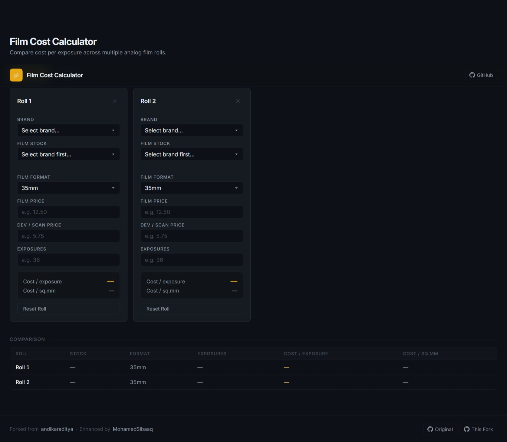

# film-calculator

> **Fork** of [andikaraditya/film-calculator](https://github.com/andikaraditya/film-calculator) — modernised UI, dynamic `config.yaml` data loading, film brand/stock picker, and side-by-side roll comparison.

Calculate the **cost per exposure** and **cost per square millimetre** for analog film rolls. Compare multiple rolls to find the best value.

[**Open Calculator**](https://MohamedSibaaq.github.io/film-calculator/)

## Features

- **Dynamic config** — film formats, brands, and stocks all come from `config.yaml`; no JS edits needed to add a new stock
- **Film stock picker** — browse Kodak, Fujifilm, Ilford, Lomography, CineStill and more; each stock shows ISO and type (Color / B&W / Slide)
- **Comparison table** — side-by-side cost breakdown across all rolls, with the cheapest highlighted automatically
- **Drag-to-reorder** — rearrange rolls by dragging
- **Auto-save** — data persists in `localStorage` across page reloads
- Up to 10 simultaneous rolls
- Fully responsive (mobile-friendly)

## Configuration

All primary data lives in [`config.yaml`](config.yaml).

| Section | Purpose |
|---|---|
| `site` | Page title, author credits, repository URLs |
| `app` | `max_rolls`, `default_rolls` on first load |
| `film_formats` | Format label, selector value, and exposure area in sq. mm |
| `film_brands` | Brands with their film stocks (name, ISO, type) |

### Adding a film stock

```yaml
film_brands:
  - brand: "My Brand"
    films:
      - { name: "My Film 400", iso: 400, type: color }
```

Valid types: `color`, `bw`, `slide`

### Adding a film format

```yaml
film_formats:
  - { label: "6x17 Panoramic", value: "617", area_sqmm: 10200 }
```

## Running locally

```bash
docker compose up --build
```

Open `http://localhost:5000` — the container is bound to loopback only (`127.0.0.1:5000`) and is meant to sit behind a reverse proxy (see [Cloud deployment](#cloud-deployment)); it's never exposed on a public interface directly.

Edit `config.yaml` and refresh; the volume mount means no rebuild is needed.

## Security hardening baseline (NIST / OWASP / CIS)

The stack includes a practical hardening baseline aligned to common controls from:
- NIST SP 800-53 (secure transport and boundary protection)
- OWASP ASVS / Top 10 (secure headers, input/request constraints, least privilege)
- CIS Docker guidance (container isolation and safer defaults)

Implemented controls in this repository:
- Strict security headers set by Flask directly (CSP, COOP, CORP, anti-MIME sniffing), applied a second time at the Caddy edge (defence-in-depth) — see [`Caddyfile`](Caddyfile).
- `GET`/`HEAD` method allowlisting and a small request body cap enforced both in Flask and at the Caddy edge.
- Reverse-proxy trust controls in Flask (`ProxyFix`) and explicit forwarded headers.
- Container least privilege: non-root app user, dropped Linux capabilities, and `no-new-privileges`.
- Read-only root filesystem for the Flask container with writable `tmpfs` only.
- The app container is bound to `127.0.0.1` only — reachable exclusively through the host's Caddy reverse proxy, never directly from the network.

Quick verification commands:

```bash
docker compose config
docker compose up -d --build
curl -I http://localhost:5000
curl -I http://localhost:5000/api/config
```

For HTTPS deployments, verify TLS and headers externally with SSL Labs and Mozilla Observatory.

## Cloud deployment

This app is designed to sit behind **Caddy running directly on the host** (not in a container), so one Caddy instance can reverse-proxy this app plus any number of other services, each with automatic HTTPS and no manual certificate handling.

### 1 — Copy files to your server

```bash
rsync -av --exclude='.git' ./ user@<ip-address>:/opt/film-calculator/
```

### 2 — Open firewall ports

```bash
# ufw (Ubuntu/Debian)
sudo ufw allow 80/tcp
sudo ufw allow 443/tcp
```

### 3 — Start the app container

```bash
ssh user@<ip-address>
cd /opt/film-calculator
cp .env.example .env   # set DOMAIN and PORT
docker compose up -d --build
```

This publishes the app on `127.0.0.1:${PORT}` only — nothing is reachable from outside the host until Caddy is set up below.

### 4 — Install and configure Caddy on the host

Install Caddy: <https://caddyserver.com/docs/install>

Create `/etc/caddy/Caddyfile` on the host:

```caddyfile
{
    email you@example.com
}

import /opt/*/Caddyfile
```

This app ships its own site block at [`Caddyfile`](Caddyfile), which the glob above picks up automatically once the repo is deployed to `/opt/film-calculator/`. It reverse-proxies `${DOMAIN}` to `127.0.0.1:${PORT}` and reapplies the same security headers as Flask.

Caddy reads `DOMAIN` and `PORT` from its process environment, so point its systemd unit at this app's `.env`:

```bash
sudo mkdir -p /etc/systemd/system/caddy.service.d
sudo tee /etc/systemd/system/caddy.service.d/override.conf <<'EOF'
[Service]
EnvironmentFile=/opt/film-calculator/.env
EOF
sudo systemctl daemon-reload
sudo systemctl reload caddy
```

Caddy automatically obtains and renews a Let's Encrypt certificate for `${DOMAIN}` the first time it starts serving that site — no certbot, no cert volumes, no renewal cron job.

The app is now live at `https://filmcalculator.tahlil.solutions/`.

### 5 — Adding another service later

Deploy the other app to its own directory under `/opt/`, e.g. `/opt/fiyavalhu-web/`, with its own `Caddyfile` snippet (its own domain and its own `reverse_proxy` target). The `import /opt/*/Caddyfile` line already picks it up — just `sudo systemctl reload caddy` after deploying it. No changes are needed to this repo or to the shared host Caddyfile.

## Roadmap

- Integrate an exchange-rate API to fetch and cache up-to-date conversion rates.
- Auto-detect user geography and set a sensible default display currency.
- Add manual currency controls so users can change currency at any time.
- Let users set and persist a preferred primary currency across sessions.
- Show roll totals and comparison values converted into the preferred currency.

## Demo




## Credits

Original project created by [**andikaraditya**](https://github.com/andikaraditya) — [andikaraditya/film-calculator](https://github.com/andikaraditya/film-calculator)

This fork maintained by [**MohamedSibaaq**](https://github.com/MohamedSibaaq).

## License

[MIT](LICENSE)
